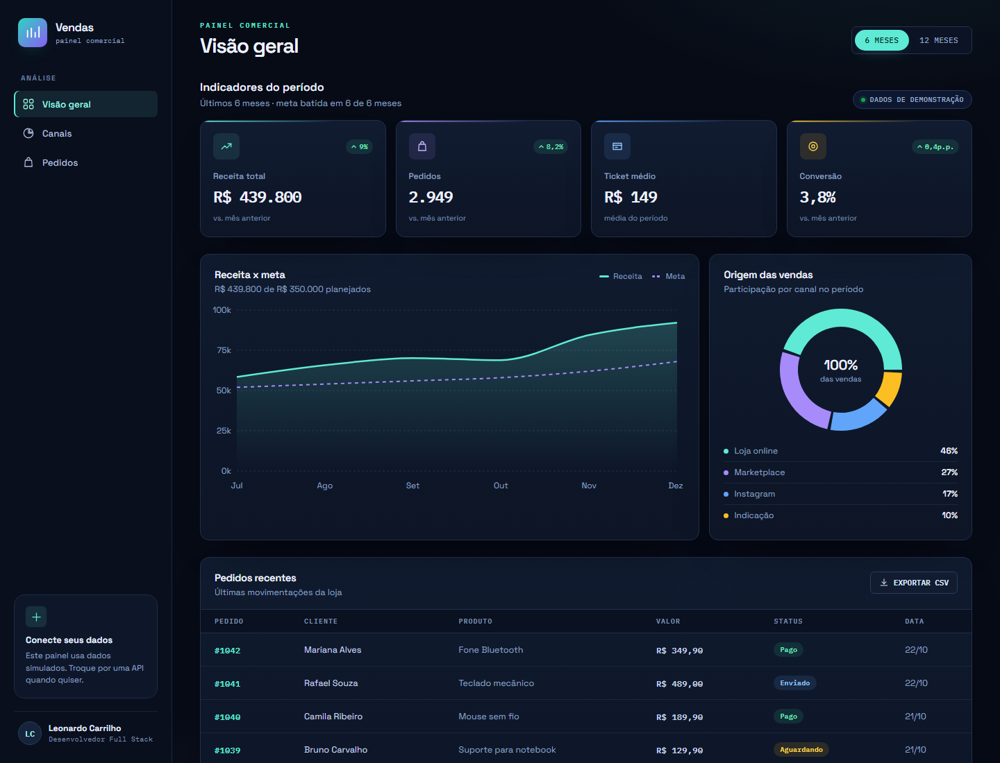

# Dashboard de Vendas

Repositório: [github.com/LeonardoCarrilho/dashboard-vendas](https://github.com/LeonardoCarrilho/dashboard-vendas)
**Demo:** [leonardocarrilho.github.io/dashboard-vendas](https://leonardocarrilho.github.io/dashboard-vendas/)

Painel comercial responsivo feito com **React + Vite + Recharts**, com indicadores, gráfico de receita x meta, origem das vendas e tabela de pedidos recentes.




## Design

Interface de analytics em tema escuro, com menta e violeta, tipografia Space Grotesk + IBM Plex Mono e cartões compactos. A intenção é parecer uma ferramenta de operação, não uma landing page.

- Contraste, foco visível e navegação por teclado revisados;
- Gráficos com cores consistentes e animações desativadas para renderização estável;
- Layout adaptado para desktop, tablet e celular.

## Funcionalidades

- Filtro de período (7, 30 ou 90 dias) que recalcula todos os indicadores
- KPIs de receita, pedidos, ticket médio e conversão comparados ao período anterior
- Última atualização dos dados exibida no topo do painel
- Gráfico de área de receita com linha de meta (por dia até 30 dias, por semana em 90 dias)
- Gráfico de rosca por canal de venda, recalculado conforme o período
- Tabela de pedidos com ordenação por cliente, valor e data (`aria-sort` e `scope="col"`)
- Exportação CSV do período ativo, com BOM UTF-8, separador `;` para o Excel pt-BR, escape de aspas e nome com o período
- Estados vazios quando não há dados no período
- Layout responsivo com menu lateral no mobile

## Como rodar

```bash
npm install
npm run dev
```

Acesse o endereço exibido no terminal (normalmente `http://localhost:5173`).

Para gerar a versão de produção:

```bash
npm run build
npm run preview
```

## Testes

Os testes usam **Vitest** e cobrem as funções puras de agregação, filtro por período, ordenação, formatação e geração do CSV.

```bash
npm test
```

## Estrutura

```
src/
├── components/
│   ├── Sidebar.jsx
│   ├── StatCard.jsx
│   ├── RevenueChart.jsx
│   ├── ChannelChart.jsx
│   └── OrdersTable.jsx
├── data/
│   └── sales.js        # dados simulados (série diária e pedidos)
├── utils/
│   ├── analytics.js    # filtro por período, KPIs, canais e série do gráfico
│   ├── csv.js          # montagem e nome do arquivo CSV
│   └── orders.js       # ordenação da tabela
├── App.jsx
├── main.jsx
└── styles.css
```

## Dados

Os números em `src/data/sales.js` são simulados para demonstração. A série diária cobre 180 dias e é derivada dos totais mensais, o que permite comparar cada período com a janela anterior. Para usar dados reais, substitua esse arquivo por uma chamada à sua API (fetch/axios) e mantenha o mesmo formato:

```js
{
  date: "2026-10-22",
  revenue: 2200,
  orders: 15,
  visits: 410,
  goal: 1900,
  channels: { loja: 1012, marketplace: 594, instagram: 374, indicacao: 220 }
}
```

## Deploy

Publicado no **GitHub Pages**: [leonardocarrilho.github.io/dashboard-vendas](https://leonardocarrilho.github.io/dashboard-vendas/).

O projeto é uma SPA estática e também pode ser publicado na Vercel ou Netlify:

- **Build command:** `npm run build`
- **Output directory:** `dist`
- **Base do Vite:** `./`, para funcionar em subdiretórios

## Licença

Uso livre para estudos e portfólio.

## Contribuição e segurança

Leia [AGENTS.md](AGENTS.md) antes de alterar o projeto. Toda tarefa exige issue e PR associado, com validação antes da publicação.

Configuração de produção, observabilidade e limites da hospedagem: [docs/SECURITY.md](docs/SECURITY.md).
