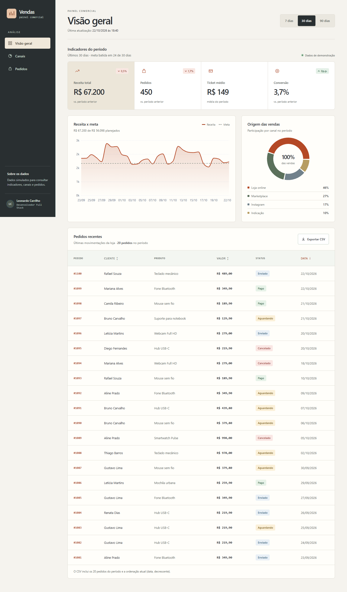
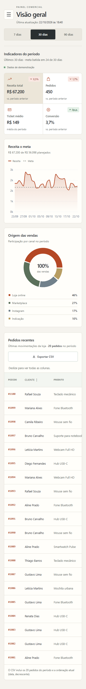

# Verificação da interface

Rodada de novembro de 2026, sobre a branch do PR de segurança existente. A captura anterior usa `main`, e não a base exata do diff deste PR.

## Escopo

Visão geral, faixa de indicadores, receita e meta, canais, ranking, tabela de pedidos, filtros de período, ordenação e exportação CSV. O menu móvel mantém contenção de foco, fechamento por Escape e retorno de foco. Os dados de demonstração, cálculos e formato do CSV permanecem os existentes. Não há fluxo de login ou CRUD neste dashboard.

## Evidência

- Build e lint passaram; 32 testes unitários passaram, com 98,72% de cobertura de linhas.
- 11 testes de navegador passaram novamente após destacar o foco do atalho de conteúdo. Incluem 320, 390, 768 e 1440 px, menu por teclado, filtro, ordenação, CSV e verificações de CSP/arquivos internos.
- `npm audit`: nenhuma vulnerabilidade. A remoção do `c8` não utilizado mantém a cobertura pelo Vitest.
- [CI da implementação](https://github.com/LeonardoCarrilho/dashboard-vendas/actions/runs/43127418807): passou.

A revisão posterior compactou os indicadores móveis em duas colunas e acrescentou a dica de rolagem horizontal da tabela. Os sete testes relevantes de relatório e responsividade passaram novamente. A faixa de indicadores mede 265 px de altura em 320 px e 275 px em 390 px, sem valores cortados; os controles permanecem com pelo menos 44 px.

## Antes e depois

| Medida observada | Antes (`main`) | Depois (branch do PR) |
| --- | --- | --- |
| Captura desktop, relatório completo | 1440 × 2041 px | 1440 × 2456 px |
| Captura móvel do relatório | Não capturada | 390 px de largura, página completa |
| Larguras verificadas por testes | Não medidas nesta rodada | 320, 390, 768 e 1440 px |
| Altura da faixa de indicadores em 320 / 390 px | Não medida no baseline | 265 / 275 px |
| Testes do baseline | Não executados nesta comparação | Resultado da implementação listado acima |

[Captura anterior do relatório](evidence/before-1440.png). Ambas as capturas desktop mostram a visão geral com os dados demonstrativos. A altura total inclui o conteúdo da tabela e não é uma pontuação de qualidade. Como o baseline é `main` e a implementação preserva o PR de segurança anterior, o antes/depois também inclui diferenças anteriores a esta rodada; não se atribui toda diferença exclusivamente ao novo CSS.

## Checker visual

O checker isolado de layout terminou com erro interno (`r.sections is not iterable`); não foi repetido nem considerado aprovado. O gate completo permanece pendente. Não há alegação de PASS visual.

A direção usa o próprio relatório como elemento visual. Tipografia local e superfícies simples evitam dependências externas. Formulários, tabelas e gráficos continuam juntos para permitir comparação; efeitos e seções de marketing não foram inseridos no fluxo operacional. Logs, perfis e capturas extensas ficam em `.taste-skill/`, fora do Git.
